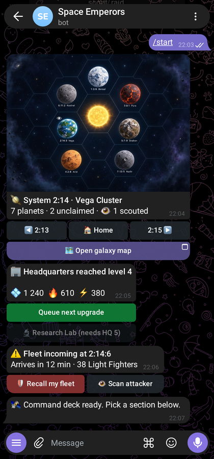
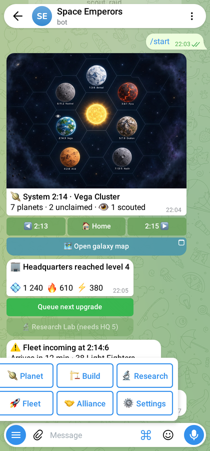
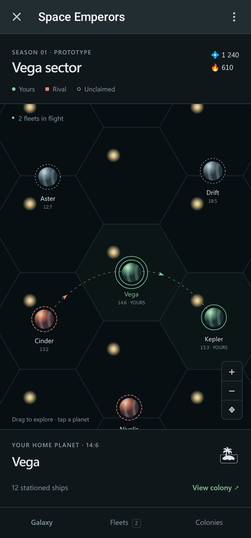
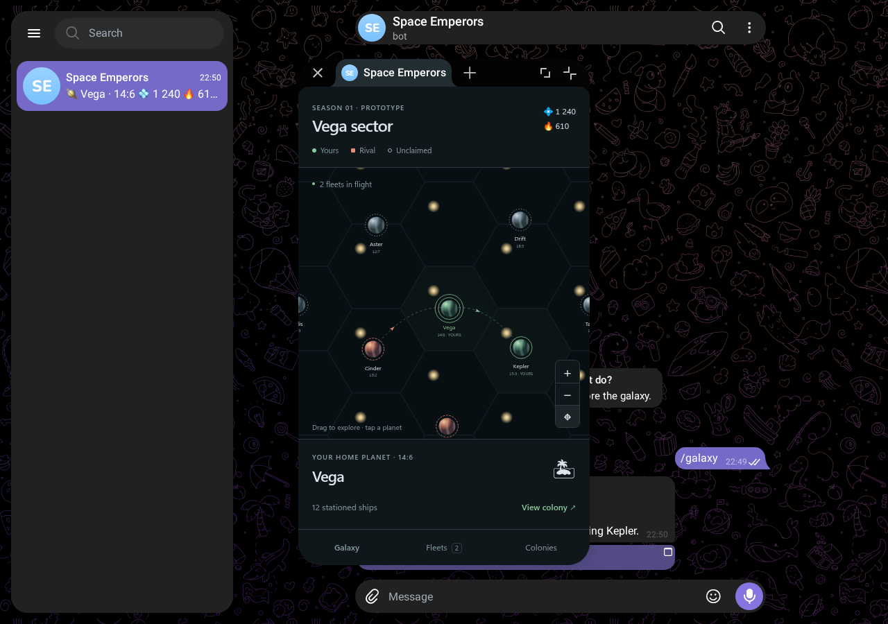
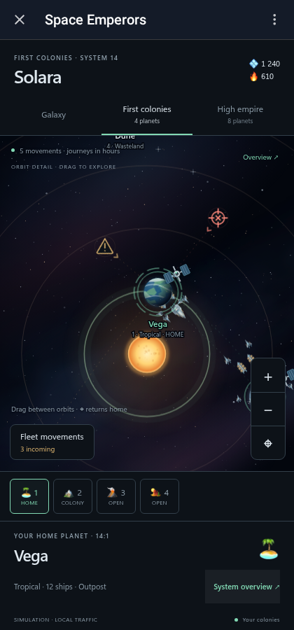
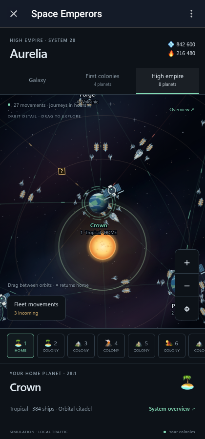

# telegram-wireframes

Wireframe a Telegram bot by writing the messages it will send. telegram-wireframes renders them with [Telegram Web A](https://github.com/Ajaxy/telegram-tt)'s own code, offline, without a Telegram account.

<p>
  
  
</p>

## Fixtures

A fixture is one chat between a user and a bot, written with [Bot API](https://core.telegram.org/bots/api) field names. The objects your bot passes to `sendMessage` or `sendPhoto` go straight in:

```json
{
  "bot": { "first_name": "Space Emperors", "commands": [{ "command": "build", "description": "Buildings" }] },
  "messages": [
    { "from": "user", "text": "/start", "entities": [{ "type": "bot_command", "offset": 0, "length": 6 }] },
    {
      "from": "bot",
      "text": "🏢 Headquarters reached level 4",
      "reply_markup": {
        "inline_keyboard": [
          [{ "text": "Queue next upgrade", "callback_data": "upgrade", "style": "success" }],
          [{ "text": "Research Lab (needs HQ 5)", "disabled": {} }]
        ]
      }
    }
  ]
}
```

Supported today:

- Text and captions with entities (bold, italic, underline, code, links, spoilers, block quotes and more).
- Photos, with paths relative to the fixture file.
- Inline keyboards: callback, URL, Web App, login, switch-inline, copy, game and invoice buttons, plus `style` and `disabled`.
- Reply keyboards, including contact, location, poll and Web App buttons.
- Bot name, description, peer color and command menu.

[`src/fixture.ts`](src/fixture.ts) has the full format, and [`examples/`](examples) has a complete chat.

## Usage

Requires [Bun](https://bun.sh), Node.js 24+ and npm 11+. Node builds Web A, and Bun runs everything else.

```sh
bun install
bunx playwright install chromium
bun run render path/to/fixture.json --keyboard
```

The first run fetches the pinned Web A commit, patches and builds it into `.cache/` (about a minute). Later runs reuse that build.

```
render <fixture.json...>   Screenshot each fixture into ./wireframes
    --theme dark,light       Themes to render
    --width 420 --height 900 --scale 2
    --keyboard               Also screenshot the opened reply keyboard
    --debug                  Print page and worker logs
serve <fixture.json...>    Serve fixtures for clicking around in a browser
```

## Mini Apps

### Space Emperors: all views

The [complete game study](examples/empire-views) covers the view shortlist and its action states. Browse chat screens rendered by Telegram, try fleet dispatch, or follow a player journey. Battle reports and round details appear in chat. Each state links to its design source and marks proposals and later scope.

```sh
bun run views:render
bun run views:serve
```

The serve command prints the connected bot and catalogue URLs. The bot menu joins all views and both admiral onboarding journeys. Follow native Telegram buttons between sample states, launch Mini Apps, and return to the menu with **All views** or `/menu`. The catalogue provides live light/dark previews, source notes and coverage export.

#### Comment on screens

The catalogue embeds Telegram's live HTML, including its Mini App frame. Choose **Add comment**, hover to highlight an element, then click it. The comment captures the element's text, HTML, DOM selector and frame location. Selecting a button in this mode opens feedback without activating the button. Press Escape to return to browsing.

Drag across words while selecting to comment on that exact text. You can also select text during normal browsing and choose **Comment on selected text**. The form fills **Quoted copy** automatically and accepts suggested replacement wording. Saved comments persist across browsers and server restarts. New comment drafts stay in the current browser tab across reloads and screen changes.

Anchors follow the selected DOM element when it scrolls or the preview zooms. Comments retain the original text and HTML if the element later changes. Existing screenshot comments and drafts retain their original images. Dark and light themes have separate comments. Use **All screens** to browse feedback, **Resolve** to close an item, or export Markdown or JSON with the captured context. Both exports include resolved comments.

The server stores feedback in `.reviews/feedback.sqlite`, outside the build cache and excluded from Git. Preserve this directory when moving the preview. The catalogue reads and writes through `/__wireframes__/review/`. `GET /__wireframes__/review/comments` returns all saved feedback for agent review, including each live comment's `target` with its selector, frame URLs, HTML and text selection offsets. Run `bun run test:review` to exercise the annotation workflow.

### Space Emperors: admirals in action

The [admiral study](examples/admiral-onboarding) compares character guides across the shortlisted art styles. Follow onboarding and later situations inside Telegram, then compare frequent portraits with milestone appearances or a factual screen. Record where the guide helps and export your choices.

```sh
bun run admirals:render
bun run admirals:serve
```

The fleet review also opens a working Mini App. Character references and scene sheets stay beside the fixture source. The game's art-style document governs every image prompt.

### Fixture format

To connect chat screens, add preview metadata outside `messages`:

```json
"navigation": {
  "buildings": "building-list",
  "/start": "welcome"
}
```

Each entry maps `callback_data` or a sent command to a fixture registered with the same server. The mock replaces the current sample screen using Telegram updates and loads photos and Mini Apps from the destination fixture's directory. Pass every destination fixture to `serve` or `render` so registration can resolve the targets.

Mini Apps open in Web A's own iframe, with Telegram's header, permission prompt and theme/event bridge. Put an HTML page next to your fixture and use its relative path in a `web_app` button:

```json
{
  "bot": { "first_name": "Space Emperors" },
  "messages": [{
    "from": "bot",
    "text": "Explore the galaxy",
    "reply_markup": {
      "inline_keyboard": [[{ "text": "Open map", "web_app": { "url": "app/index.html" } }]]
    }
  }],
  "mini_app": { "button_text": "Open map", "ready_selector": "[data-ready='true']" }
}
```

`mini_app` is preview metadata. The renderer clicks that inline button, confirms Telegram's permission prompt, waits for the selector inside the iframe, and saves an extra `-mini-app.png`. Without this metadata you can still launch the app manually. The fixture server serves local HTML, CSS, JavaScript and SVG files. An absolute `web_app.url` can point to your app's dev server.

The mock supplies Telegram launch parameters, including theme, platform and version, and an empty `tgWebAppData`. Mock your app's authentication and game API for wireframes. Production `initData` validation belongs in the real server.

Try the [galaxy prototype](examples/galaxy): a map with mouse/finger drag, pinch and wheel zoom, animated planet surfaces, ownership colors and rings, and fleet trajectories that advance from timestamps. It uses sample state and has no game API.

The map study has three views, also selectable with `?variant=galaxy`, `?variant=young` or `?variant=developed` on the app page:

- Galaxy places a small, dim astronomical object or multiple system in every hex, with sparse settlements against a coloured starfield and nebulae. Zoom out to see thousands of systems, then pan and zoom into a distant region.
- First colonies has four different biomes around a central star, with a home planet, a second colony and two unclaimed worlds.
- High empire has eight settled planets, orbital stations, patrol craft and resource transports.

The map fills the space below the tabs. Tap a star or planet for a popover with its details and actions; tap elsewhere or press Escape to dismiss it. Fleet details also float over the map.

The full galaxy sample represents one sector, following the game's [sector design](https://github.com/JosXa/space-emperors/blob/main/docs/game-design.md#sector-size-and-expansion). The nebula is a cached image. Hexes and stars render to a canvas with a margin around the viewport, using cached stellar sprites. Panning translates that bitmap; zooming, resizing or crossing its margin rebuilds the visible region through an axial-coordinate lookup. At overview scale, the whole sector fits in the bitmap and dragging needs no redraw. SVG overlays hold visible settlements, selection and fleets. Arrow keys select adjacent systems; Enter opens their details.

System orbits are spaced for panning on a phone. Planet targets stay 64 pixels wide at every zoom, while their artwork grows with zoom up to a fixed size. Tap an orbit or its planet to select it without moving the camera. The orbit buttons approach individual worlds.

Galaxy stars use O–B–A–F–G–K–M spectral classes and separate V/III/I luminosity classes. The catalogue also includes binary and triple systems, DA/DB white dwarfs, neutron stars and pulsars, and stellar-mass black holes with companions. These follow [stellar evolution categories](https://science.nasa.gov/universe/stars/types/) and [black-hole mass classes](https://science.nasa.gov/universe/black-holes/types/). Tap a whole hex to inspect its classification, or open **Star classes** for the key. Ordinary systems reveal their names on selection, keeping settlements prominent. Colours are enhanced and symbols enlarged: true stellar diameters disappear at interstellar map scales. Distribution, planet counts and positions are illustrative.

Fleet positions follow departure and arrival timestamps over journeys lasting minutes or hours. Faint, static dotted trajectories show each fleet's remaining journey. Compact incoming markers pulse gently: an amber warning for unverified contacts, a red target for verified attacks, and a blue shield for verified reinforcements. Tap a marker for details and scanning. The map carries no persistent fleet labels. Your heavy warships, small freighters and Light Fighters travel in formation, with provisional silhouettes and no settled ship statistics. Arrivals end movements rather than looping them.

Open **Fleet movements** to inspect unknown incoming fleets, a verified attack and your own transports. Scan the allied incoming fleet to reveal reinforcements and its ship composition. The report identifies its movement leg and verification time. The preview controls demonstrate expiry on recall, arrival or replacement. Unknown fleets have no composition or mission in their initial fixture state, including allied fleets. The scan uses a separate static response under `app/intel/`; production authorization and visibility belong on the game server. Scan range and travel times are sample values.

```sh
bun run serve examples/galaxy/fixture.json
bun run render examples/galaxy/fixture.json
# A desktop shot shows the app floating above the chat:
bun run render examples/galaxy/fixture.json --theme dark --width 1280 --height 900 --scale 1
bun run test:mini-app
bun run perf:mini-app
# Longer drags cross the bitmap cache boundary; combine with CPU slowdown:
CPU_RATE=4 PAN_DISTANCE=360 bun run perf:mini-app wireframes/performance/pan-4x.json
```

The performance command measures 180 drag frames at neighbourhood, regional and sector zoom inside Telegram's iframe. It covers desktop and phone-sized viewports, including a 2× pixel ratio, and writes frame timings and main-thread time to JSON. Run it without competing browser jobs; CPU throttling and viewport emulation do not replace testing on a physical phone. See the [performance report](reports/sector-pan-2026-10-10.md) for the measured before/after results.

<p>
  
  
</p>

<p>
  
  
</p>

[Full eight-planet system](docs/system-developed-full.png)

[Galaxy overview](docs/galaxy-wide.png) and [selected-system popover](docs/galaxy-selection.png).

[Incoming fleet](docs/fleet-incoming.png), [fleet scan and ship silhouettes](docs/fleet-espionage.png), and [astronomical catalogue](docs/galaxy-catalogue.png).

## How it works

Web A ships a mocked client for its own tests. telegram-wireframes pins a Web A commit, applies [a small patch](patches/web-a.patch) that repairs the mock client and adds a hook, and injects [a loader](inject/) into Web A's worker. The loader fetches your fixture from a local server and converts the Bot API objects into the MTProto objects Telegram's servers would send. From there, Web A renders the chat as it would any other, and Playwright takes the screenshot.

Web A changes weekly. `upstream.json` pins the commit. [`.opencode/commands/update-web-a.md`](.opencode/commands/update-web-a.md) describes how to move the pin forward and repair the patch.

## License

[GPL-3.0-only](LICENSE), because the project distributes a patch to Telegram Web A, which is GPL-3.0.
